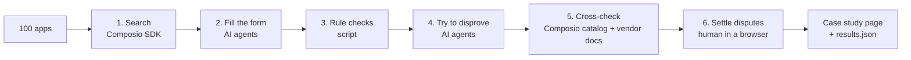

# Which of these 100 apps can become an agent toolkit today?

My submission for the **Composio AI Product Ops Intern** take-home.

I built an AI research pipeline, powered by Composio's own SDK, that looked into 100 apps and answered, for each one: *how do you log in to its API, can a developer get access on their own, what does the API cover, is there an MCP server, and could Composio turn it into a toolkit today?* Then I spent most of my effort on the part that matters most, **checking whether the answers are actually right**.

| | |
|---|---|
| **Case study (start here, ~2 min read)** | **[https://radhikakundnani.github.io/composio-toolkit-feasibility/](https://radhikakundnani.github.io/composio-toolkit-feasibility/)**, or download this repo and open [`site/index.html`](site/index.html) in any browser |
| **All the data, machine-readable** | [`site/results.json`](site/results.json) |
| **The code** | [`pipeline/`](pipeline/) |

---

## The short version

1. **90 of the 100 apps can be built as toolkits today.** 48 with no caveats and 42 with one caveat (a paid plan, an app review, or a small API). Only 8 need a sales or partner conversation, and 2 aren't hosted services at all.
2. **Composio already covers 80 of them.** I pulled Composio's full catalog (1,842 toolkits) and matched it. Of the 20 gaps, 9 could be built right now, 3 need a paid test account, 6 need outreach, and 2 are command-line tools.
3. **11 existing Composio toolkits use API keys even though the vendor offers OAuth** (Close, Twilio, Freshdesk, Cloudflare, Copper, Plain, Pumble, Twenty, Firecrawl, MongoDB Atlas, Grain). That's a cheap upgrade to a better login experience.
4. **Access gates follow the money.** Productivity and developer tools are almost all free to access (19 of 20). Ad platforms (Google, Meta, LinkedIn, Pinterest) and fintech (Brex, Ramp, Plaid) are where you need approval or a sales call.
5. **86 of 100 apps already have an official MCP server**, and MCP was also where the AI got confused most often.
6. **The AI knew when it was guessing.** Answers it marked "low confidence" were wrong 60% of the time; "high confidence" answers only 2%. So a human only needs to review about 5% of answers, which is what makes this approach work for hundreds of apps instead of 100.

---

## How it works, in plain English



**Step 1: Search (no AI yet).** For every app, a script runs four web searches through Composio: one about login/auth, one about pricing and access, one about the API, and one about MCP servers. That's 400 searches and 2,000 results. Every result is saved with Composio's log ID, so any answer can be traced back to the exact search that produced it.
→ [`pipeline/gather.py`](pipeline/gather.py), [`pipeline/composio_tools.py`](pipeline/composio_tools.py)

**Step 2: Fill in the form (first AI pass).** Ten AI agents worked in parallel, ten apps each. Each one read only the saved search results (no browsing, no answering from memory) and filled in the same fixed form for every app. Every answer had to cite a source link and say how confident the agent was. Keeping this pass strict gave me an honest baseline to measure improvements against.
→ [`pipeline/prompts/extract.md`](pipeline/prompts/extract.md), output in [`data/v1/`](data/v1/)

**Step 3: Rule checks (a script, not AI).** Simple automatic checks that catch obvious mistakes: Does the cited link still work? Did the source actually come from a Composio search? Does the verdict contradict itself (for example "ready to build" but "needs a sales call")? Any blanks? On the first pass this flagged 40 of the 100 apps.
→ [`pipeline/checks.py`](pipeline/checks.py)

**Step 4: Try to prove it wrong (second AI pass).** Ten new agents re-checked all 100 apps with *fresh* Composio searches, and their job was to try to disprove each answer, not confirm it. Every change they made is logged with a reason and a source. They fixed outdated pricing (for example Pipedrive and Freshdesk no longer have free plans), filled in unknowns, and swapped blog posts for official docs.
→ [`pipeline/prompts/verify.md`](pipeline/prompts/verify.md), output in [`data/v2/`](data/v2/) and [`data/v2_log/`](data/v2_log/)

**Step 5: Cross-check against independent sources.** I compared every answer with two sources the AI didn't produce:
- **Composio's own catalog**, which already records how 80 of these apps log in. This is how I caught the AI saying "has OAuth" for 9 apps where OAuth only existed for the vendor's MCP server, not the actual API.
- **The vendor's own docs page**, fetched through Composio, to check that the claim is actually written there.
→ [`pipeline/catalog.py`](pipeline/catalog.py), [`pipeline/doccheck.py`](pipeline/doccheck.py)

**Step 6: Settle disputes (human in the loop).** When sources disagreed, I opened the vendor's page in a browser and decided. Every decision is written down with its reason in [`data/adjudications.json`](data/adjudications.json). I also hand-checked a random sample of 20 apps (2 per category, picked before I saw any AI output) and used it to score each step.

---

## How I know the results are right

I scored every step against the 20-app hand-checked sample, field by field (auth, access, MCP, verdict):

| Step | Accuracy | What changed |
|---|---|---|
| First AI pass | **93.8%** | baseline |
| After the "try to disprove it" pass | **96.2%** | fixed outdated plans, filled unknowns; but also broke 2 correct answers |
| After cross-checks + human decisions | **97.5%** | fixed the 2 it broke, plus 9 OAuth over-claims across all 100 |

Two things I want to be upfront about:
- **My hand check was wrong 3 times too.** For example, I said Aircall had no official MCP server, but a Composio search found Aircall's own help article. Wherever the AI and I disagreed, I re-checked both sides, and I've listed those corrections on the page.
- **One known error is left visible on purpose:** Freshdesk's MCP status. Neither AI pass caught it, and fixing only the sample apps would have made the score look better than it really is.

Across all 100 apps, 77 were checked by 4 or 5 independent sources. Citations from the vendor's own website went from 93% to 98%.

---

## Where a human was needed

- **Setup:** creating the Composio API key. My first key was read-only and couldn't start a session, so I made one with write access.
- **Judgement calls:** deciding that "free trial" counts as self-serve, and that a docs-search MCP doesn't count as an "official" MCP. I wrote these rules into the verifier's instructions.
- **Name collisions:** "Paygent" matches at least 4 different products; Sherlock, Mermaid and fanbasis had similar traps. The hint text was the only way to tell them apart.
- **Disputes:** the verifier made Twilio and Neo4j *worse*, and Aircall's own docs contradict each other. I settled all three on the vendor's page.
- **Matching Composio's catalog:** 15 app names didn't match automatically. Checking by hand caught that Composio's `mermaid_chart_mcp` is a different product from Mermaid CLI.
- **Publishing safely:** GitHub blocked my first upload because some scraped docs pages contained sample tokens (Slack, Discord, Twilio). I added a redaction step ([`pipeline/redact.py`](pipeline/redact.py)) that removed 35 of them, and the pipeline now strips them automatically.

## What didn't work

- **Paygent Connect:** I couldn't confirm which "Paygent" is the NMI-powered one, so its access is still marked unknown.
- **Rate limits:** the free page-fetch tool hit its hourly limit, so most evidence comes from search snippets (1–3k characters of page text) rather than full pages.
- **25 access claims** come from pages that don't literally say the plan (often because pricing loads with JavaScript), so they rely on search snippets.
- **A few cited links have since gone dead** (they return 404). They're listed in [`data/v2_flags.json`](data/v2_flags.json).

---

## Run it yourself

**Just look at the results (no setup):** open [https://radhikakundnani.github.io/composio-toolkit-feasibility/](https://radhikakundnani.github.io/composio-toolkit-feasibility/), or download the repo and double-click `site/index.html`.

**Re-check my accuracy numbers (no API key needed, about 1 minute):**
```bash
git clone https://github.com/radhikakundnani/composio-toolkit-feasibility
cd composio-toolkit-feasibility
python3 pipeline/score.py v1      # first AI pass vs the hand-checked sample
python3 pipeline/score.py v2      # after the "try to disprove it" pass
python3 pipeline/score.py final   # after cross-checks and human decisions
```

**Run the research yourself (needs a free Composio API key):**
```bash
python3 -m venv .venv && .venv/bin/pip install composio python-dotenv
echo 'COMPOSIO_API_KEY=your_key_here' > .env      # the key needs write access
.venv/bin/python pipeline/composio_tools.py search "Attio API authentication"   # try one search
.venv/bin/python pipeline/gather.py 4 21          # research specific apps by id (Attio, Slack)
python3 pipeline/checks.py v1                     # run the rule checks
.venv/bin/python pipeline/report.py               # rebuild the case study page
```
Steps 2 and 4 (the AI passes) are instruction files in [`pipeline/prompts/`](pipeline/prompts/). Any AI agent can follow them; I ran them with Claude subagents.

---

## What's in this repo

```
pipeline/            the code, one file per step
  composio_tools.py    Composio search + fetch, with caching and token redaction
  gather.py            step 1: 4 searches per app
  prompts/             steps 2 and 4: instructions for the AI agents
  checks.py            step 3: rule checks and live link checks
  catalog.py           step 5: match against Composio's 1,842-toolkit catalog
  doccheck.py          step 5: check claims against the vendor's docs
  score.py             accuracy vs the hand-checked sample
  analyze.py           deeper analysis (calibration, coverage, priority)
  report.py            builds the case study page
data/
  apps.json            the 100 apps from the assignment
  evidence/            what the searches returned, per app
  v1/ v2/ final/       answers after each step
  v2_log/              every change the verifier made, and why
  ground_truth.json    my hand-checked sample (with sources)
  adjudications.json   every dispute I settled, and why
  cache/               raw Composio tool results (with log IDs)
site/
  index.html           the case study page
  results.json         everything, for other agents to read
```

## A few terms, if they're new

- **Toolkit:** a ready-made set of actions an AI agent can use in an app (for example "create a HubSpot contact").
- **OAuth vs API key:** two ways to log in to an API. OAuth is the "Sign in with…" flow, best when many different users connect their own accounts. An API key is a single password-like string, simpler but per-account.
- **Self-serve vs gated:** can a developer get access by signing up, or do they need to pay, get approved, or talk to sales?
- **MCP server:** a standard way for AI assistants to connect to an app. Many vendors now publish their own.

*Research run: 23 Nov 2026. App pricing and MCP availability change quickly, so every answer links to the page it came from.*
